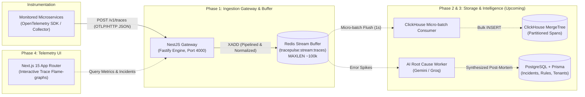

# ⚡ TracePulse — Distributed Telemetry & AI Incident RCA Platform

> **Target Level:** SDE 1 ➔ SDE 2 Engineering Transition  
> **Core Focus:** High-Throughput Stream Ingestion, OpenTelemetry Standards, Columnar Storage (ClickHouse), Redis Streaming Buffers, and Automated AI Root-Cause Synthesis.

---

## 🏗️ Architecture & Data Pipeline



---

## 🚀 Key SDE 2 Engineering Design Decisions

1. **High-Throughput Gateway with Fastify:**
   - Swapped Express for `@nestjs/platform-fastify`, yielding lower serialization latency and sub-15ms round-trips for high-volume telemetry ingestion.
   - 10MB payload body limit accommodates deep microservice call stacks and large span batches.

2. **Redis Streams Decoupling (`XADD` with Approximate Trimming):**
   - The ingestion gateway **never** queries or writes directly to ClickHouse or Postgres during the HTTP request path.
   - Pushes payloads to `tracepulse:stream:traces` using `MAXLEN ~ 100000`. The approximate `~` flag ensures $O(1)$ trimming time complexity, preventing Redis memory exhaustion during sudden traffic spikes without CPU spikes.

3. **Strict OpenTelemetry OTLP/HTTP Compliance:**
   - Endpoint `POST /v1/traces` accepts official OpenTelemetry protobuf JSON payloads (`ExportTraceServiceRequest`).
   - Dynamically unrolls `AnyValue` attribute types (string, int, float, bool, kvlist) into a clean key-value map.
   - Converts 32-character hexadecimal trace IDs into RFC 4122 UUID strings (`8-4-4-4-12`) for direct native indexing in ClickHouse.
   - Automatically detects error statuses from HTTP 5xx codes or exception attributes when the upstream instrumentation sets `STATUS_CODE_UNSET`.

---

## 📂 Monorepo Structure

```
TracePulse/
├── apps/
│   ├── api/                 # NestJS + Fastify Ingestion Gateway & Services
│   │   ├── src/
│   │   │   ├── ingestion/   # OTLP Ingestion Controller, Normalizer & Service
│   │   │   ├── redis/       # Redis Stream Producer with Pipelining
│   │   │   ├── clickhouse/  # ClickHouse Client Service
│   │   │   ├── prisma/      # PostgreSQL Prisma Client
│   │   │   └── health/      # Health check checking all 3 downstream stores
│   │   └── prisma/          # Schema for Users, Projects, Incidents, AlertRules
│   └── web/                 # Next.js 15 Dashboard (App Router, Tailwind CSS)
├── packages/
│   ├── shared/              # Shared OTLP interfaces, domain contracts, constants
│   └── tsconfig/            # Monorepo TypeScript base configs
├── docker/
│   └── clickhouse/          # Init SQL table script (ClickHouse MergeTree)
├── docker-compose.yml       # Production-ready ClickHouse, PostgreSQL, and Redis stack
├── scripts/
│   └── send-mock-trace.sh   # Automated curl script simulating OTel span dispatch
└── package.json             # Root monorepo orchestration
```

---

## ⚡ Quickstart

### 1. Prerequisites
- **Node.js**: `v20+` or `v24+`
- **pnpm**: `v9+` or `v10+`
- **Docker & Docker Compose**

### 2. Start Local Storage Infrastructure
```bash
# Starts ClickHouse (8123, 9000), PostgreSQL (5432), and Redis (6379)
docker compose up -d

# Verify container health
docker compose ps
```

### 3. Install Dependencies & Push Database Schema
```bash
# Install monorepo dependencies
pnpm install

# Build shared contracts
pnpm --filter @tracepulse/shared build

# Sync PostgreSQL schema with Prisma
pnpm --filter @tracepulse/api prisma:push
```

### 4. Start the Ingestion Gateway
```bash
# Development watch mode
pnpm --filter @tracepulse/api dev

# Or build & start production
pnpm --filter @tracepulse/api build
pnpm --filter @tracepulse/api start:prod
```

### 5. Verify Health
```bash
curl -s http://localhost:4000/health | jq
```
Expected output:
```json
{
  "status": "healthy",
  "services": {
    "redis": "up",
    "clickhouse": "up",
    "postgres": "up"
  }
}
```

### 6. Send a Test OpenTelemetry Trace
```bash
./scripts/send-mock-trace.sh
```

Inspect the queued spans in Redis:
```bash
docker exec -it tracepulse-redis redis-cli XRANGE tracepulse:stream:traces - + COUNT 1
```

### 7. Run Unit Tests
```bash
pnpm --filter @tracepulse/api test
```
