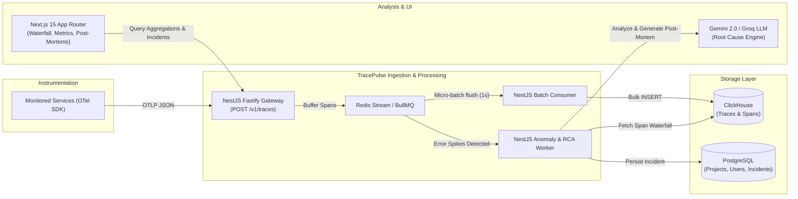

# Project 1: TracePulse — Distributed Telemetry & AI Incident RCA Platform
> **Target Level:** SDE 1 to SDE 2 transition  
> **Core Focus:** Backend Systems, High-Throughput Ingestion, Time-Series Databases, Queues, Observability, and Agentic AI Diagnosis.

---

## 1. Executive Summary & Problem Statement
Modern microservice architectures generate millions of telemetry events (spans, logs, metrics). When an outage occurs, on-call engineers waste hours manually correlating logs across services to find the root cause. 

**TracePulse** is an open-source, lightweight APM (Application Performance Monitoring) and incident intelligence platform. It accepts OpenTelemetry-compliant traces, buffers and stores them in ClickHouse for real-time querying, detects anomaly spikes, and automatically reconstructs the failing call tree so an LLM worker can synthesize an actionable root-cause post-mortem.

---

## 2. Core Architecture & Data Flow



---

## 3. Technology Stack (100% Free / Open Source)
* **Backend Services:** Node.js, TypeScript, NestJS (Fastify adapter for maximum throughput).
* **Buffer & Queuing:** Redis Streams & BullMQ.
* **Databases:**
  * **ClickHouse (Docker):** Columnar storage engine optimized for high-volume time-series trace analytics.
  * **PostgreSQL + Prisma:** Relational storage for tenants, API keys, service definitions, alert rules, and incident post-mortems.
* **Frontend:** Next.js (App Router), React, Tailwind CSS, Shadcn UI, Apache ECharts (for latency percentiles), Custom SVG Canvas for trace flame-graphs / waterfall timelines.
* **AI Analysis:** Google Gemini API (Free Tier) or Groq Llama-3 API.

---

## 4. Key Data Models

### ClickHouse: `spans` Table
```sql
CREATE TABLE default.spans (
    trace_id UUID,
    span_id String,
    parent_span_id String,
    service_name LowCardinality(String),
    name LowCardinality(String),
    kind LowCardinality(String),
    start_time DateTime64(6, 'UTC'),
    end_time DateTime64(6, 'UTC'),
    duration_ms Float64,
    status_code LowCardinality(String), -- 'OK', 'ERROR', 'UNSET'
    status_message String,
    attributes Map(String, String),
    events_nested Nested(
        time DateTime64(6, 'UTC'),
        name String,
        attributes Map(String, String)
    )
) ENGINE = MergeTree()
PARTITION BY toYYYYMM(start_time)
ORDER BY (service_name, status_code, start_time, trace_id);
```

### PostgreSQL: Core Prisma Schema
* `User`: Authentication, roles.
* `Project`: Project name, slug, owner.
* `ApiKey`: Ingestion keys with rate limit tiering.
* `Incident`: `id`, `project_id`, `service_name`, `error_rate`, `p99_latency_ms`, `summary`, `root_cause_markdown`, `status` (`OPEN`, `RESOLVED`), `created_at`.
* `AlertRule`: Metric target (e.g. `P99 > 800ms`), window (e.g. `60s`), status.

---

## 5. Milestone Implementation Roadmap

### Phase 1: Local Infrastructure & Ingestion Gateway (Week 1)
- [ ] Configure `docker-compose.yml` with ClickHouse, PostgreSQL, and Redis.
- [ ] Initialize NestJS API with Prisma and Fastify.
- [ ] Create `POST /v1/traces` endpoint matching OpenTelemetry OTLP/HTTP JSON standard.
- [ ] Push ingested span payloads to a Redis stream buffer to decouple HTTP writes from database persistence.

### Phase 2: High-Throughput Batch Processing & Anomaly Worker (Week 2)
- [ ] Implement a BullMQ consumer that micro-batches spans and flushes them to ClickHouse every 1 second or 1,000 spans.
- [ ] Write a Node.js mock trace generator script that simulates 3 microservices (Frontend, API Gateway, Payment, Database) firing normal and failing requests.
- [ ] Implement an Anomaly Detector running every 30 seconds that queries ClickHouse for P95/P99 latency regressions and error-rate surges.

### Phase 3: AI Root-Cause Engine & Span Tree Reconstruction (Week 3)
- [ ] Write a tree-traversal algorithm that reconstructs parent-child span hierarchies from raw flat span lists in $O(N)$ time.
- [ ] Extract the critical path: filter for spans with `status_code == 'ERROR'` or `duration_ms > threshold`.
- [ ] Prompt the LLM with the sanitized error stack traces, span timings, and SQL query attributes to generate a structured post-mortem (Trigger, Impact, Root Cause, Action Items).
- [ ] Save the incident report to PostgreSQL.

### Phase 4: Next.js Dashboard & Trace Waterfall (Week 4)
- [ ] Build Next.js dashboard with Shadcn UI.
- [ ] Real-time time-series charts (RPM, Error %, P50/P95/P99 latency).
- [ ] Interactive Trace Explorer: Gantt-style waterfall timeline of nested spans.
- [ ] Incident Center: List of active/resolved outages with the AI-generated post-mortem.

---

## 6. Resume Bullet Points (Ready for CV)
* *“Architected an OpenTelemetry-compliant observability platform in NestJS and ClickHouse capable of ingesting and querying 5,000+ spans/second with sub-second analytical latencies.”*
* *“Designed an asynchronous stream-processing pipeline using Redis Streams and BullMQ to buffer high-throughput ingestion spikes, preventing database thread exhaustion.”*
* *“Engineered an automated root-cause analysis worker that correlates distributed span trees across microservices and generates structured incident post-mortems using LLM synthesis.”*
* *“Built an interactive Next.js telemetry dashboard featuring custom SVG trace waterfall visualizations and real-time latency percentile tracking.”*
